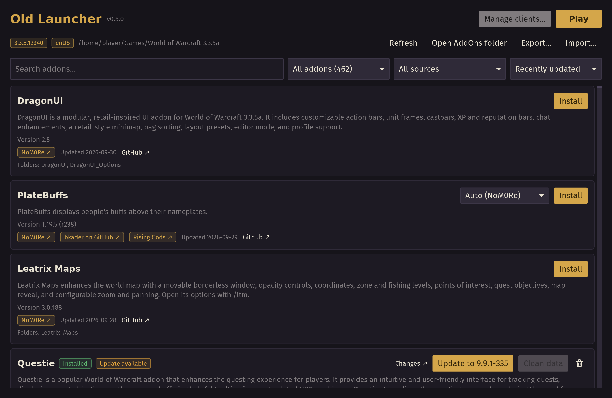
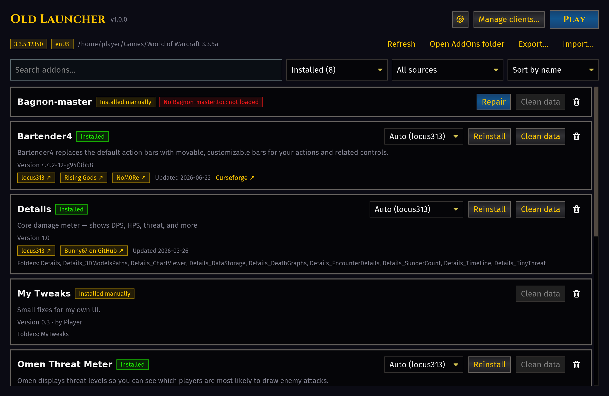
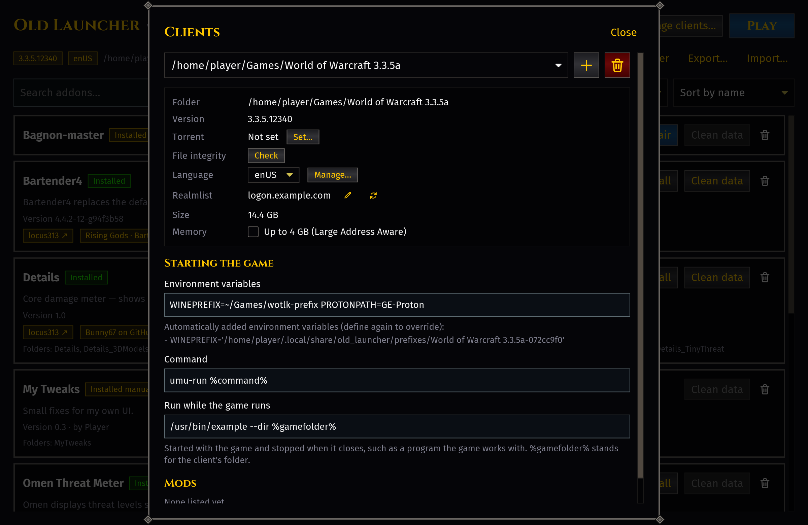
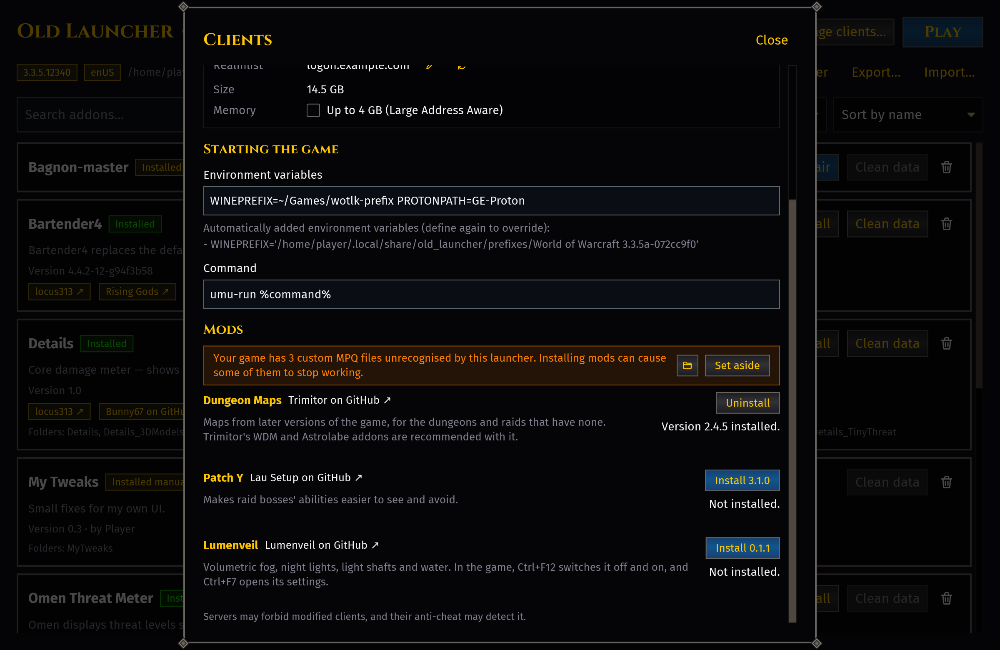
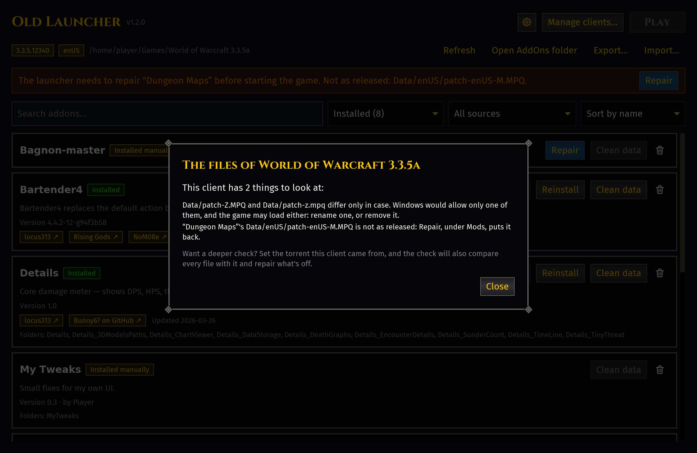
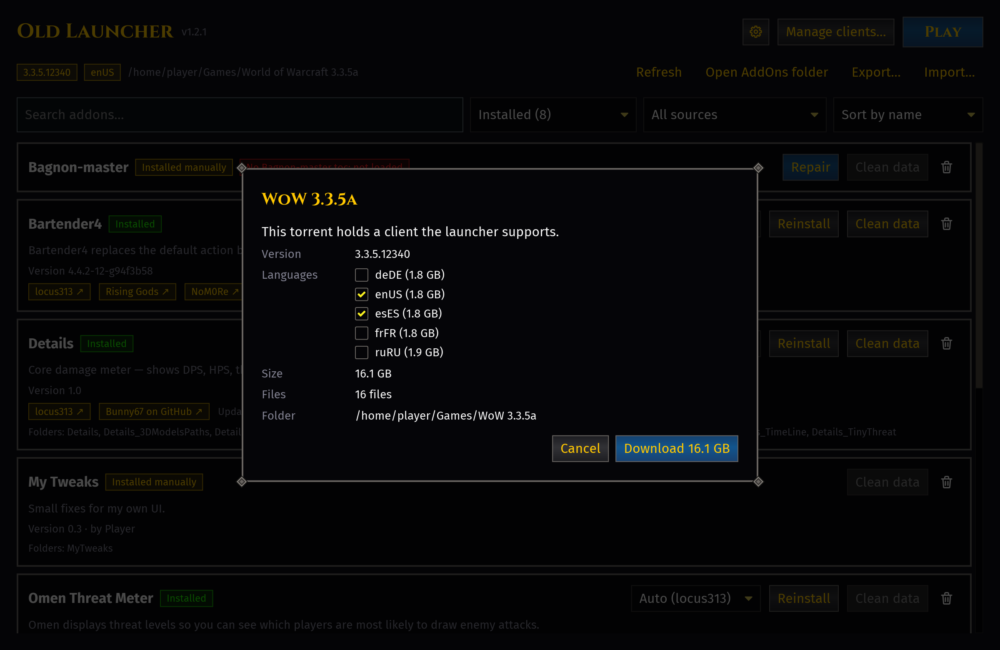
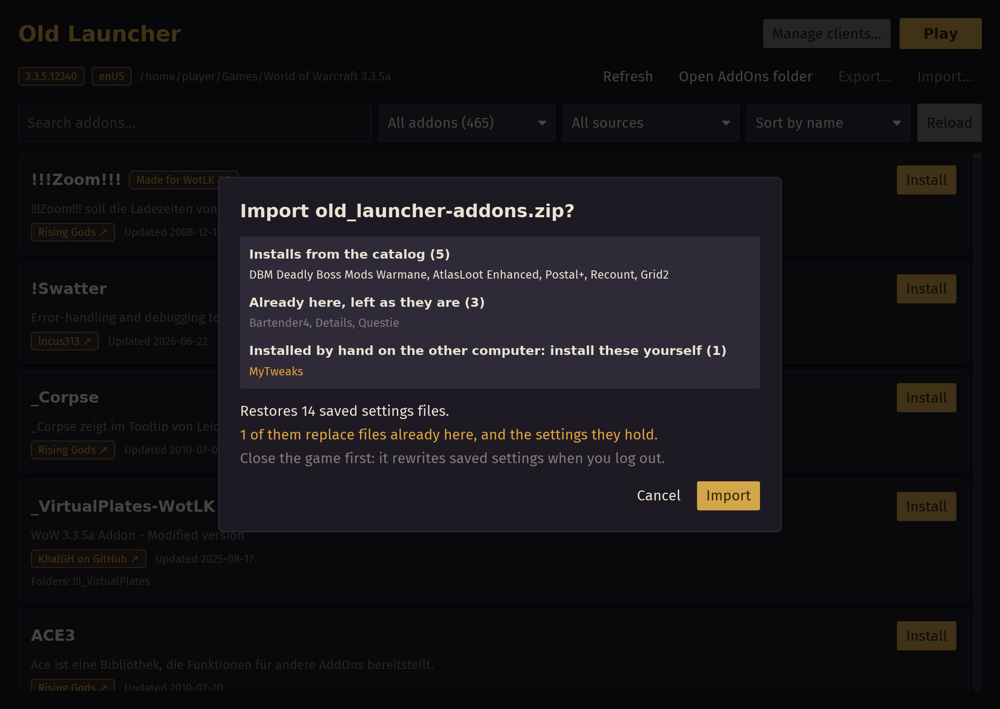

# Old Launcher

A launcher and addon manager for World of Warcraft 3.3.5a clients.

**[Download for Linux](https://old-launcher.icarns.xyz/old_launcher-linux-x86_64)**
**[Download for Windows](https://old-launcher.icarns.xyz/old_launcher.exe)**

[Linux on ARM64](https://old-launcher.icarns.xyz/old_launcher-linux-arm64)
· [Arch Linux (AUR)](https://aur.archlinux.org/packages/old-launcher-git)

It's a portable program: nothing to install, just run it.

- **Windows** (64-bit, Windows 10 or newer): run `old_launcher.exe`. It isn't
  signed, so Windows may warn about an unknown publisher: choose *More info*,
  then *Run anyway*.
- **Linux** (64-bit, any distribution from 2018 or later, because of glibc):
  make the file executable (`chmod +x` on it), then run it. Or install it
  from the [AUR](https://aur.archlinux.org/packages/old-launcher-git).

## What it does

- **Play**: on Linux through Proton (umu-launcher), Wine or any runner, under GameMode when installed, each client in a Wine prefix of its own.
- **One list** of every addon, available and installed, to search and filter.
- **Install** or reinstall with one click, from the freshest source or the one you pick.
- **Install an addon from outside the list**, from a folder or an archive.
- **Update** addons that have a newer version available, and the launcher itself.
- **Manage** addons: uninstall, clean saved settings, repair broken folders.
- **Dependencies**: shows what each addon requires, and warns before uninstalling one that others need.
- **Recognizes** the addons you installed before the launcher, and tells when you changed one it installed.
- **Export** addons and settings to a zip; **import** it on another computer.
- **Several clients** side by side (3.3.5a only).
- **Download a client** from a torrent, in the languages you choose; later download or delete languages.
- **Check any client**: its patches and mods, and with the torrent it came from, every file, repairing what's off.
- **Switch the language** of a client that has more than one.
- **Server**: shows which server a client connects to, warns when its realmlist won't work, and opens it to edit.
- **4 GB of memory** for a client's game (Large Address Aware), for HD textures and long view distances.
- **Mods** for the client, such as [Lumenveil](https://github.com/lumenveil/Lumenveil) (fog, lamp light, water), [Patch Y](https://github.com/CRSD-Lau/Lau-Setup), [Dungeon Maps](https://github.com/Trimitor/WDM-patch) and, on Windows, [DXVK](https://github.com/doitsujin/dxvk): install, update, repair or remove them per client.
- **Keeps your patches working**: before a mod goes in, it reads the client's MPQ patches, refuses an install that would break one, and says what it would override.
- **Custom patches**: lists the MPQ patches it doesn't recognise, to open their folder or set them all aside.
- **Show on Discord** that you're playing, if you want.

Shortcuts: <kbd>Ctrl</kbd>+<kbd>F</kbd> search, <kbd>F5</kbd> refresh,
<kbd>Esc</kbd> close dialogs, <kbd>Ctrl</kbd>+<kbd>Q</kbd> quit.

## Where the addons come from

The list of addons is put together from these collections, and refreshed
every week:

- [NoM0Re/WoW-3.3.5a-Addons](https://github.com/NoM0Re/WoW-3.3.5a-Addons),
  a curated collection, together with NoM0Re's own addon repositories.
- [locus313/WoW-3.3.5a-Addons](https://github.com/locus313/WoW-3.3.5a-Addons),
  a curated collection of backports.
- Backport maintainers on GitHub: ElvUI-WotLK, bkader, Bunny67, Zidras,
  s0h2x, KhalGH, Sattva-108, Xurkon, Wrath-AddOns.
- [Trimitor/WDM-addons](https://github.com/Trimitor/WDM-addons), addons
  made for the Dungeon Maps mod.
- [UndeadRogue/wow-3.3.5a-addons](https://github.com/UndeadRogue/wow-3.3.5a-addons),
  addons and ElvUI plugins.
- Addon authors on GitLab: juxuanu (Kekator).
- [CurseForge](https://www.curseforge.com/wow), for the addons with a file
  for patch 3.3.5 whose authors let other apps download it.
- [WoWInterface](https://www.wowinterface.com), for the addons whose last
  version was made for patch 3.3.
- [Rising Gods](https://addons.rising-gods.de/addons), a server's collection
  (descriptions in German).

When several of them offer the same addon, the newest version is installed;
you can also pick another source instead.

Missing an addon? Ask for it on
[GitLab](https://gitlab.com/juxuanu/old_launcher/-/issues/new?issuable_template=Addon%20request)
or on [Discord](https://discord.gg/tS35paspnf).

## Good to know

- Outside your client folders, the launcher writes only its settings file,
  `~/.config/old_launcher/config.toml` on Linux and
  `%APPDATA%\old_launcher\config.toml` on Windows, and a cache in
  `~/.cache/old_launcher` or `%LOCALAPPDATA%\old_launcher`: a copy of the
  addon list, so it doesn't need to be downloaded every time you open the
  launcher, a copy of each client's torrent, fetched again from its peers
  if missing, each mod's last download, so installing it again downloads
  nothing, and the list of fonts installed on your computer, made again
  when they change. On Linux, Wine also keeps a prefix for each client in
  `~/.local/share/old_launcher/prefixes`, about 0.6 GB each, unless the
  client's launch settings set `WINEPREFIX`.
- A client downloading from a torrent goes into a `.download` folder
  inside the folder you chose, its files into place once complete.
  It is shared with the others downloading it, as BitTorrent works, until
  it is done: the launcher listens for them on a port, opened on your
  router through UPnP, which Windows' firewall may ask about.
- Every addon folder it installs gets a small `.old_launcher.toml` file
  saying where it came from, and so does a client folder, beside `Wow.exe`,
  for its torrent and mods: a client removed and added back keeps them. The
  game ignores them; the launcher uses them to tell what can be updated.
- Downloads from GitHub, which limits anonymous ones, can sign in with
  `GH_TOKEN`, `GITHUB_TOKEN` or your GitHub CLI login. The launcher never
  stores a token.

Developers: see
[DEVELOPMENT.md](https://gitlab.com/juxuanu/old_launcher/-/blob/main/DEVELOPMENT.md).
